# ragnarok-offline

A single-player server for one specific, preserved Ragnarok Online client: the
**euRO (Ragnarok Online Europe) closed-beta CD of December 2003**
(`Ragexe.exe` built 2003-12-18). The original client connects to it
unmodified, with no exe patching, and you play alone on your own machine.

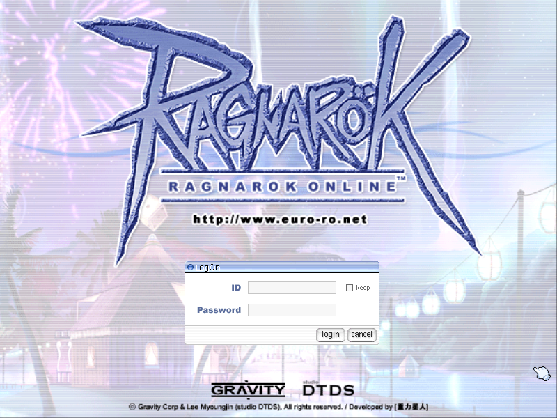

> **Playable, and not accurate yet.** You can play a character from the
> training ground through the first and 2-1 jobs: the period world, its NPCs
> and quests, skills, monsters that fight back, pets, carts. A lot of what
> the server decides is still an approximation. Nothing of euRO's server
> survives, so every number, formula and line of dialogue has to be
> reconstructed from period sources. See [Status](#status) and
> [Why accuracy is slow](#why-accuracy-is-slow).

The server is written in Rust. Everything a period server decided (NPCs,
warps, spawns, damage, HP/SP, regen...) lives in Lua scripts and TOML tables
you can edit while the server runs.

## Screenshots

All taken from the unmodified 2003 client talking to this server (800×600,
the client's own resolution).

| | |
|---|---|
| 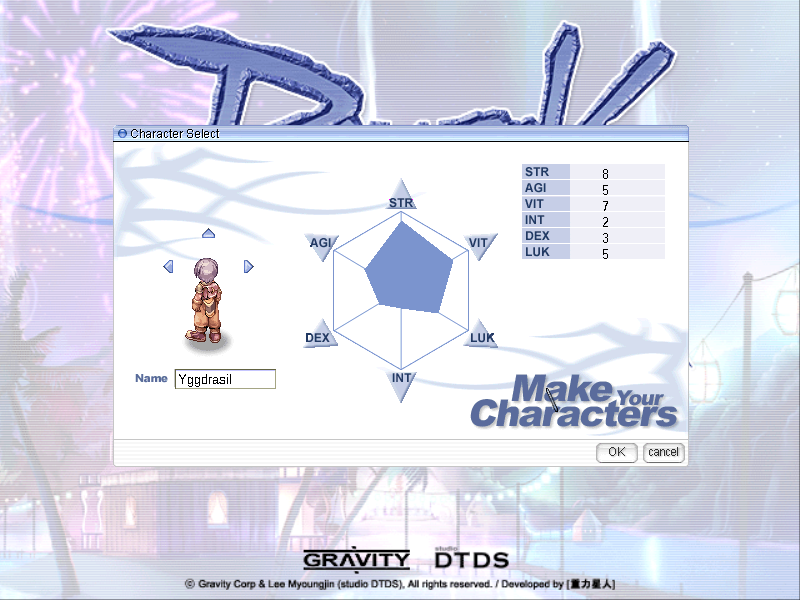 | 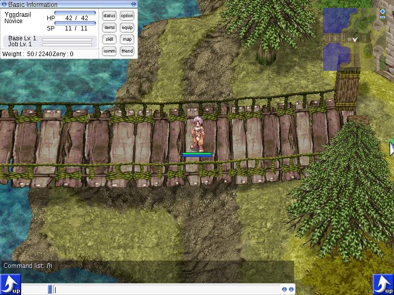 |
| Character creation | The novice training ground as this client has it (`new_zone01`–`04`). Servers of the time called it `new_1-1`; the client maps one name to the other itself |
| 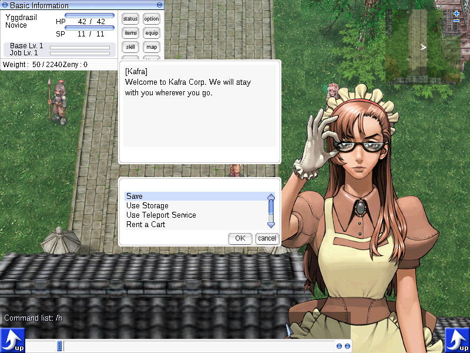 | 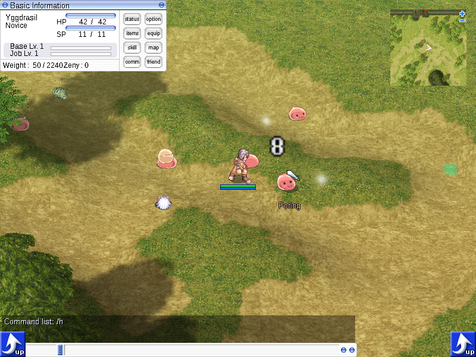 |
| Payon as it was before the town was rebuilt, and its Kafra: save, storage, teleport, cart rental | The first Poring. Melee combat, EXP, drops and monster spawns follow December 2003 emulator data |
| 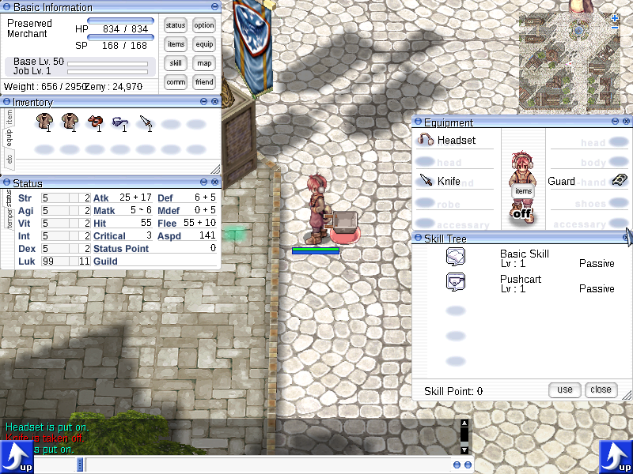 | 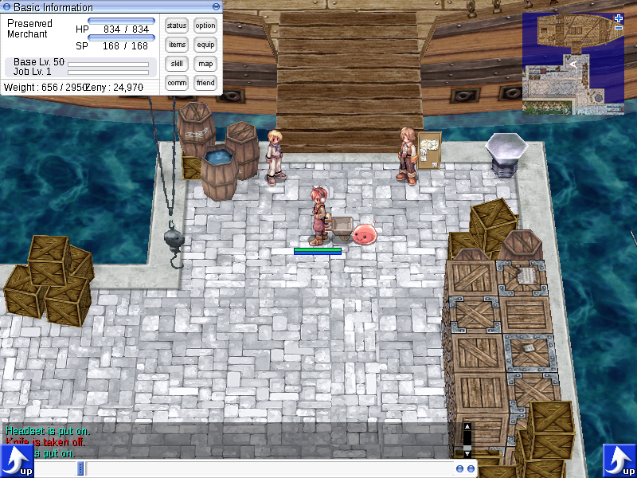 |
| The period interface, a Merchant's pushcart and a pet Poring (euRO announced "Q-Pet" as part of its closed beta) | Alberta's docks |
| 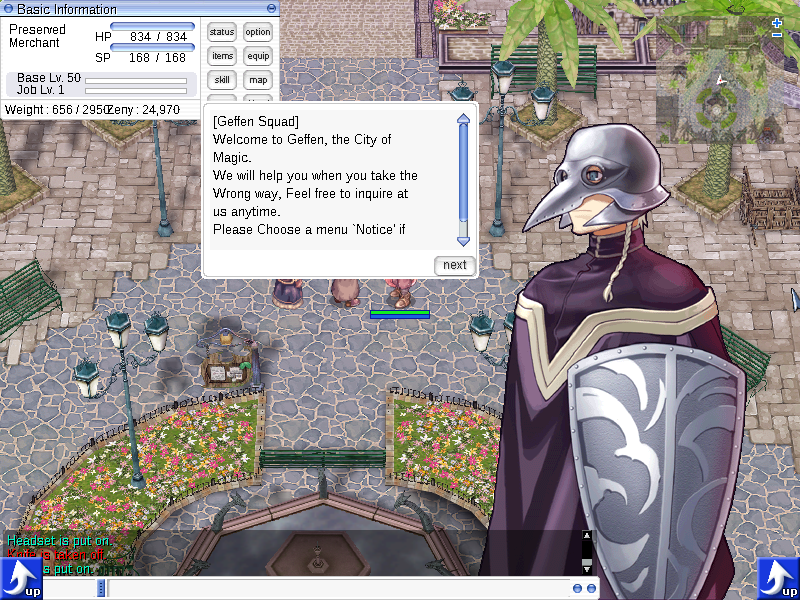 | 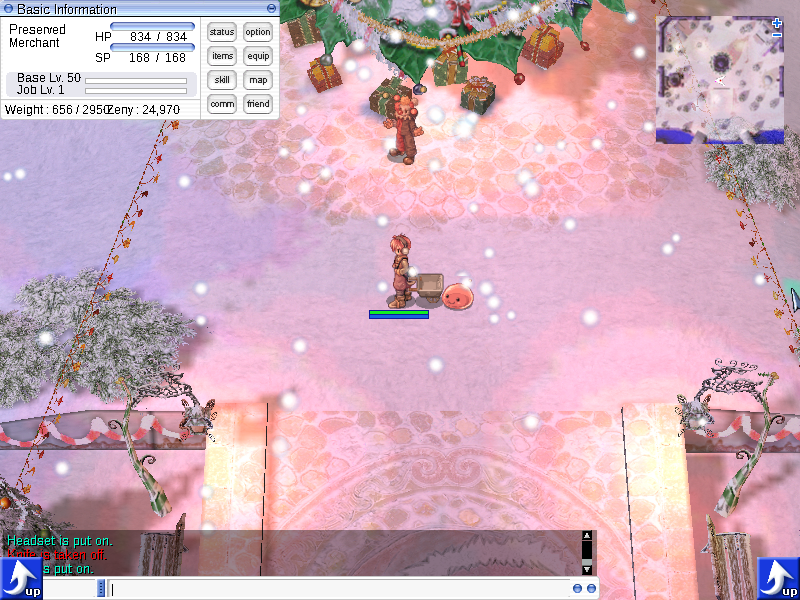 |
| A Geffen guide. 611 NPCs are translated from a February 2004 emulator release | Lutie |
| 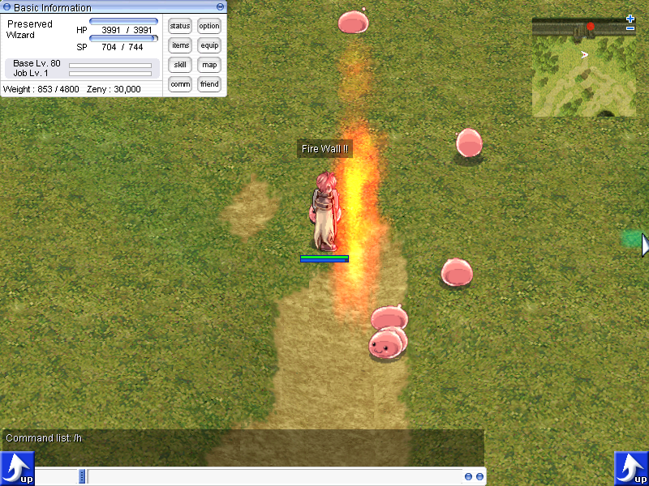 | 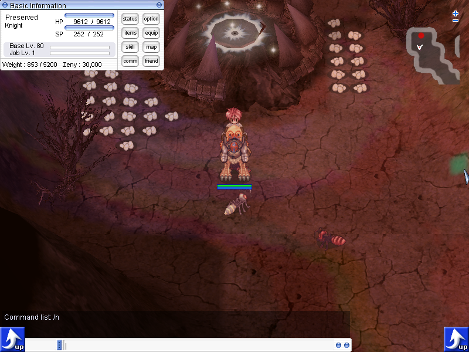 |
| Fire Wall. The skills of the first and 2-1 jobs work as the December 2003 emulator had them: cast times, SP, ground skills, status changes | Ant Hell, entered through one of the scripted doors of the period warp list (they remember which desert you came from) |
| 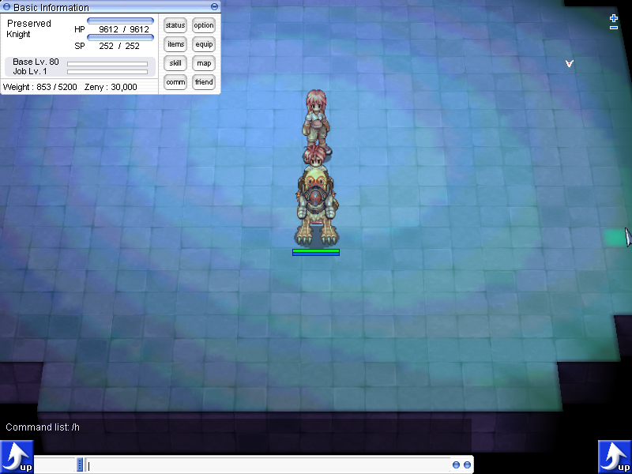 | 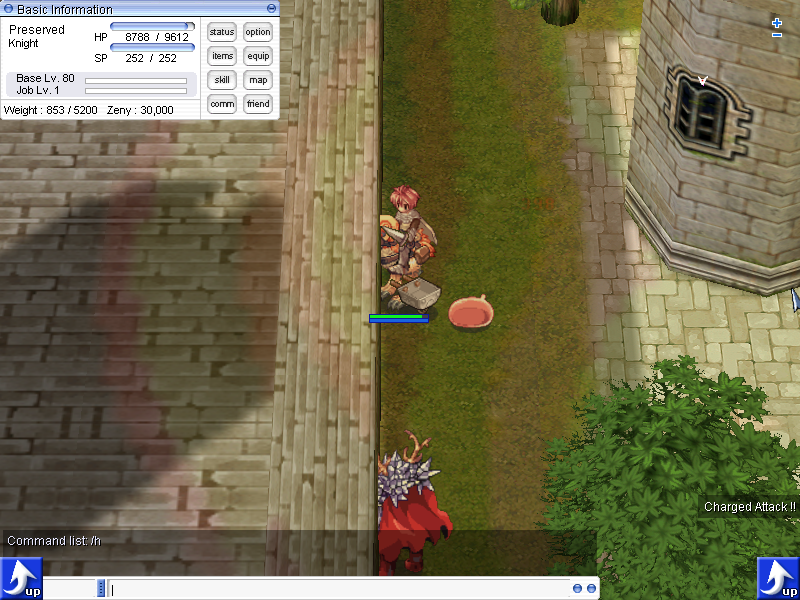 |
| The Wizard test's waiting room on `job_wiz`, a map this CD carries only in a patch file. Candidates once queued here; alone, you may lounge or ask to go in | A guild castle nobody owns. Until February 2004 an ownerless castle filled with monsters; with one player no castle ever has an owner |
| 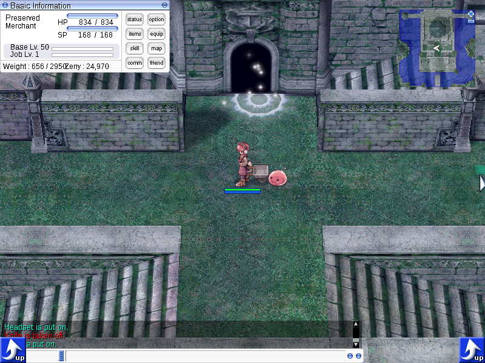 | 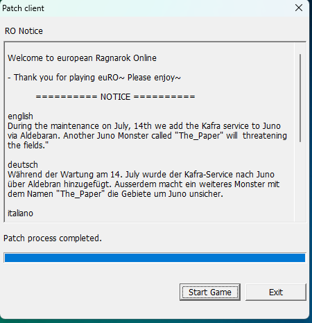 |
| Glast Heim's entrance | The CD's own patcher on Windows 11, showing euRO's notice (English, German, Italian) from a 2004 Wayback Machine capture served by a local stand-in for euRO's patch server |

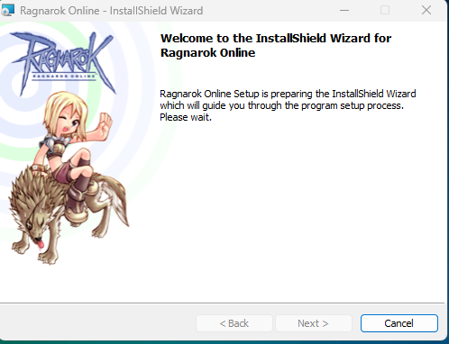

The original 2003 installer also still runs on Windows 11
([docs/WINDOWS.md](docs/WINDOWS.md)).

## What is on the disc

Full identification, with evidence: [docs/CLIENT.md](docs/CLIENT.md). In short:

- **The official European service, not a private server.** euRO was run by
  Burda Holding International under a licence signed with Gravity on
  2003-11-26. The closed beta started 2003-12-20, two days after this exe was
  built. Open beta followed on 2004-02-04 and the paid service on 2004-04-15.
- **An English Gravity client of the iRO lineage**, service type `germany`,
  pointing at euRO's login server `62.109.138.134:6900`, with the
  `http://www.euro-ro.net` login artwork.
- **The plain pre-2004 wire protocol** (what eAthena later called
  `packet_ver 5`). The packet length table used here was read out of the exe.
- **269 maps**: Prontera, Geffen, Payon, Morroc, Alberta, Izlude, Al De Baran,
  Comodo, Lutie, Glast Heim, plus Turtle Island and Juno shipped as un-merged
  patch files. euRO itself only opened Juno and the 2-2 jobs on 2004-06-09,
  so they are off by default here.
- The CD itself is most likely a magazine cover disc (CHIP Italia, June
  2004) carrying the December 2003 build. Its image is preserved on the
  Internet Archive: [ragnarok-online-euro-cd-2003-12-ichipm01](https://archive.org/details/ragnarok-online-euro-cd-2003-12-ichipm01).
  [docs/PRESERVATION.md](docs/PRESERVATION.md) records the rip and how the
  disc was identified.

## Status

This is the short version. [docs/ROADMAP.md](docs/ROADMAP.md) is the list
that is kept current: what is done, what is next, and where each answer
would come from. [docs/DEVIATIONS.md](docs/DEVIATIONS.md) says where the
game knowingly differs from the period one.

Working with the real client:

- login, character create/delete/select, saving;
- every map of the client and the period warps between them, including the
  random exits of the Clock Tower and Payon Cave. `ragnarok-offline check`
  walks the client's own map cells from the start point and reports
  anything a player could not reach;
- about 600 period NPCs: towns, the novice training ground, job quests,
  guides, Kafras (fares, storage, saving, carts, points), refiners, dye
  makers, quests, shops; the Turtle Island chain; the job test of every 2-1
  job (Knight, Priest, Wizard, Blacksmith, Hunter, Assassin), on the maps this
  client has for them. Every first-job and 2-1 test has been played through
  in the real client;
- inventory, equipment, cards, item identification, usable items, Kafra
  storage, pushcarts, forging and ore refining;
- pets: taming, eggs, hunger, intimacy, accessories;
- **skills**: the Novice, the six first jobs and the six 2-1 jobs, with cast
  times, delays, SP and item costs, ground skills and traps, status changes
  and ailments with their icons. The Assassin's, Blacksmith's, Hunter's,
  Wizard's, Priest's and Knight's skills have been tried in the real client;
- battle as the period emulators have it: elements, sizes, cards, refine
  bonuses, criticals, arrows; monsters with their period AI and skills;
  EXP, drops, MVP rewards;
- a drop-in Windows launcher that runs the CD's own patcher against a local
  patch server, and an all-in-one installer built from your own disc.

Not yet, or only in part:

- **the 2-2 jobs.** This client's exe knows none of their skills (euRO
  opened them in June 2004 with a later client, which turns out to survive on a
  magazine DVD of July 2004), so the ones drafted so far can only be used
  through a GM command
  ([research/THREADS.md](research/THREADS.md) #25);
- how the 2-1 job tests went on euRO in early 2004. Their scripts are the
  emulators' of 2004 (the Assassin's, the Blacksmith's and the Knight's of
  autumn 2004), and no player account dates most of them that early;
- a handful of skills are drafts from thin evidence (ROADMAP §3), and the
  NPC dialogue is the emulator authors' fan translation, not Gravity's.

Out of scope because nobody else is there: parties, guilds, trading, vending
and PvP. What to do with War of Emperium and the guild dungeons in a
single-player game is decided in principle (rework them for one player once
the original is understood, THREADS.md #17) and not built. For now the guild
castles hold what an ownerless castle held in early 2004: monsters.

## Why accuracy is slow

euRO ran Gravity's own server software, which was never released, and none of
euRO's server data survives. So the goal, the game as a euRO player met it
between December 2003 and February 2004, cannot be copied from anywhere. It
has to be reconstructed, and each value has to say where it came from.

Every server-side value carries a tier ([docs/PROVENANCE.md](docs/PROVENANCE.md)):

| Tier | Meaning | What sits there today |
|---|---|---|
| `client` | Read from the client's files or the exe: confirmed | Packet lengths, map cells, the path finder and walk step times, skill SP costs, Basic Skill unlocks, names, sprites |
| `official` | Gravity or publisher material from the period | The patcher's notice and patch list (Wayback captures of euRO's patch server) |
| `athena2003` | Athena-family emulators contemporary with the client (2003-12 to 2004-05) | Almost everything else: items, monsters, drops, EXP, formulas, warps, spawns, NPC scripts, pets, refining |
| `period` | Community documents of 2002–2004 | Little so far |
| `later` | Reconstructions after 2004, which often describe 2008–2012 rather than 2003 | Avoided. `@go` coordinates only |
| `guess` | Our estimate | The start cell, monster AI, some display defaults |

Most of the game is on the `athena2003` tier. Those emulators are good
evidence of the official game, but they are not the official game. Their
authors guessed too, and they disagree with each other: Kafra fares shown
and charged differ within one release, Baphomet has 568k HP in December 2003
data and 668k in February 2004, armor DEF per refine level is recorded as 1,
5 and 0.7 in three versions. The NPC dialogue is the emulator authors' fan
translation, not Gravity's English text.

Moving a value up a tier means finding a period source for it: a Korean patch
notice, an archived iRO guide page, a 2003 forum post, a magazine scan, a
screenshot with coordinates in it. That is slow, one question at a time.
The open questions are numbered in [research/THREADS.md](research/THREADS.md)
(closed-beta EXP rates, the real start cell, Kafra fares before
2004-02-24, how 2-1 job changes worked before the "New Comodo" update,
where Gravity's 2003 English NPC text survives, and more). Where the project
knowingly differs from the period game, mostly because one player is not a
server full of people, it says so in [docs/DEVIATIONS.md](docs/DEVIATIONS.md).

Two sources are ruled out: leaked Gravity server files, which are not ours
to use, and silently substituting later values for period ones.

### You can help

If you played euRO, iRO or kRO in 2003–2004 and still have any of the
following, it is evidence: screenshots (especially with `/where`
coordinates, NPC dialogue, Kafra menus or fare lists), saved guides and FAQs,
forum archives, bot logs and configs of the time, magazine articles about
the euRO beta, or simply a clear memory of how something worked that you can
date. Open an issue and say which thread it answers.

## Play

There is no binary release yet. Build the packages from source
([docs/DEVELOPMENT.md](docs/DEVELOPMENT.md): `tools/wb exec tools/package.sh`
writes them to `dist/`). You need the client from the CD. It is Gravity's and
is not in this repository. The server supports exactly one client, the one
on this disc: [the CD image on the Internet Archive](https://archive.org/details/ragnarok-online-euro-cd-2003-12-ichipm01)
(`RAGNAROK.iso`, sha256 `b5d579a4…19a6`). Mount it and run its `setup.exe`,
or build the all-in-one installer from it (below).

### Windows 10/11

1. Install the client from the CD (or copy an installed `RagnarokOnline` folder).
2. Put **`RagnarokOffline.exe`** into that folder (next to `Ragexe.exe`) and
   double-click it. That's all: the first start prepares the folder once
   (UAC prompt only if it is under Program Files). Then, as in 2003, the
   CD's patcher shows euRO's notice (an archived snapshot, served locally)
   and you click **Start Game**.
3. Log in with **any new ID and password** (4+ characters): the account is
   created on first login. Add `_F` to the ID once to make a female account
   (`myname_F`), `_M` for male (default).

`RagnarokOffline.exe` contains the server, its scripts and database, and
[DDrawCompat](https://github.com/narzoul/DDrawCompat) (DirectX 7 fixes for
modern Windows, XP-style text). Fullscreen is emulated (no display mode
change, 4:3 with black bars); the client's own `Setup.exe` still changes
resolution, sound and so on. Your saves, scripts and `ragnarok-offline.toml`
end up in `<game>\offline\` (or `%LOCALAPPDATA%\Ragnarok Offline\` if the
game folder is read-only).

Own the CD? `tools/aio/build.sh` turns it into an **all-in-one installer**:
the original setup wizard, plus all of the above, prepared at install time.
Details, and what the 2003 installer and client do on Windows 11:
[docs/WINDOWS.md](docs/WINDOWS.md).

### By hand (server CLI)

Unzip `ragnarok-offline-<version>-windows-x86_64.zip` anywhere, then in a terminal:

```bat
ragnarok-offline.exe setup --client "C:\Program Files (x86)\Gravity\RagnarokOnline"
ragnarok-offline.exe init --client "C:\Program Files (x86)\Gravity\RagnarokOnline"
ragnarok-offline.exe run
```

`setup` keeps the CD's `data.grf` as `data.grf.original`, writes a new
`data.grf` with the CD's Turtle Island/Juno patches merged (what euRO's
patcher would have done) and a `clientinfo.xml` pointing at 127.0.0.1, and
adds `Play Offline.bat`; `init` writes `ragnarok-offline.toml`. Start the game
with `Play Offline.bat`. The server needs Windows 10 or newer (or 7/8 with the
Universal C Runtime update); the client needs DDrawCompat or a similar
wrapper for fullscreen on modern Windows (`RagnarokOffline.exe` installs it).

### Linux

Put `RagnarokOffline` from `ragnarok-offline-<version>-linux-x86_64.tar.gz` into the
client folder and run it (server + `wine Ragexe.exe 1rag1`; configure the client
with `wine Setup.exe` first). Or by hand, with the static `ragnarok-offline` binary:

```sh
./ragnarok-offline setup --client ~/RagnarokOnline
./ragnarok-offline init --client ~/RagnarokOnline
./ragnarok-offline run &
cd ~/RagnarokOnline && wine Ragexe.exe 1rag1
```

## Change the game while it runs

```sh
ragnarok-offline console                     # Lua REPL inside the running server
ragnarok-offline eval 'player.zeny = 50000'  # one-off, as the first online player
```

Edit any file under `scripts/` and it reloads automatically; in game,
`@reload` does the same and `@help` lists the admin commands (your
auto-registered account is GM level 99 by default).

## Documentation

| | |
|---|---|
| What the disc is | [docs/CLIENT.md](docs/CLIENT.md) |
| How it was preserved | [docs/PRESERVATION.md](docs/PRESERVATION.md) |
| How the server is built | [docs/ARCHITECTURE.md](docs/ARCHITECTURE.md) |
| Wire protocol, and what is confirmed from the exe | [docs/PROTOCOL.md](docs/PROTOCOL.md) |
| Writing NPCs, rules, commands (Lua) | [docs/SCRIPTING.md](docs/SCRIPTING.md) |
| Where every number comes from | [docs/PROVENANCE.md](docs/PROVENANCE.md) |
| What we do differently from 2003, on purpose | [docs/DEVIATIONS.md](docs/DEVIATIONS.md) |
| Open research questions | [research/THREADS.md](research/THREADS.md) |
| What is missing / next | [docs/ROADMAP.md](docs/ROADMAP.md) |
| Building, testing, the headless client rig | [docs/DEVELOPMENT.md](docs/DEVELOPMENT.md) |
| Modern Windows: launcher, all-in-one installer, what the 2003 CD does on Win11 | [docs/WINDOWS.md](docs/WINDOWS.md) |

## License

GPL-3.0-or-later ([LICENSE](LICENSE)). `data/db/*.toml` and
`scripts/import/**` are generated from, and the NPC scripts are ported from,
the GPL-licensed Athena-family emulators of 2003–04 (Athena, AppleMod,
eAthena); the project as a whole is GPL so they can live in it. Bundled
DDrawCompat is 0BSD (its licence ships next to it).

The client and its data are Gravity's and are never in this repository. The
screenshots under `docs/img/` show Gravity's artwork as rendered by the
original client; they are here to document the project. Ragnarok Online is a
trademark of Gravity Co., Ltd. This project is not affiliated with Gravity or
with euRO's former operators.
